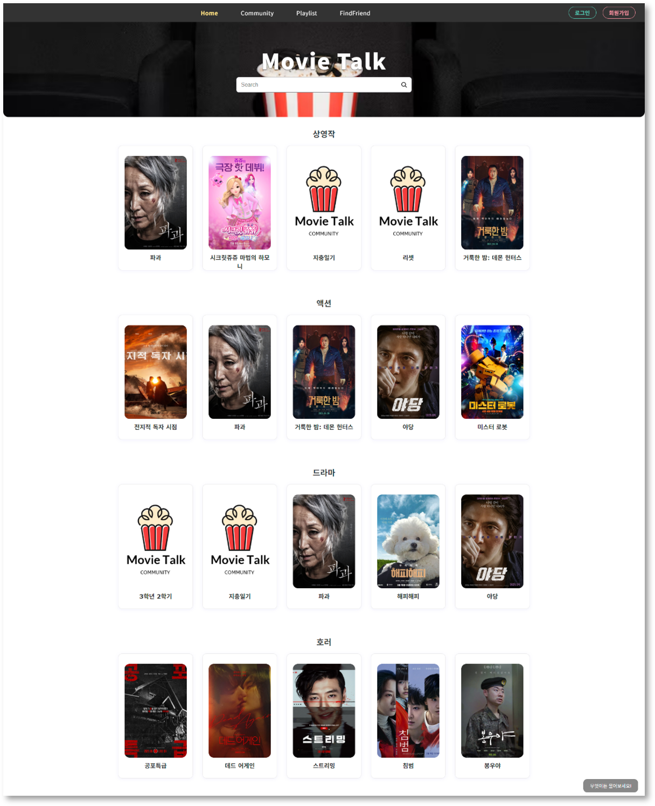

---
# multilingual page pair id, this must pair with translations of this page. (This name must be unique)
lng_pair: id_movietalk
title: "MovieTalk - 영화 취향을 공유하는 캡스톤 웹 서비스"

# post specific
# if not specified, .name will be used from _data/owner/[language].yml
#author: ""
# multiple category is not supported
category: 프로젝트
# multiple tag entries are possible
tags: [캡스톤, React, Spring Boot, MySQL, 팀 프로젝트]
# thumbnail image for post
img: "/assets/img/projects/movietalk.png"
# disable comments on this page
#comments_disable: true

# publish date
date: 2025-03-04 09:00:00 +0900

# seo
# if not specified, date will be used.
#meta_modify_date: 2025-03-04 09:00:00 +0900
# check the meta_common_description in _data/owner/[language].yml
#meta_description: ""

# to disable this page, simply set published: false or delete this file
#published: false
---

<!-- outline-start -->

영화 정보를 검색하고, 좋아하는 영화를 모아 다른 사용자와 취향을 공유하는 웹 서비스 **MovieTalk**를 4인 캡스톤 팀에서 개발했습니다. 저는 팀장으로 참여해 마이페이지, 플레이리스트, 친구 찾기 기능의 백엔드를 구현했습니다.

<!-- outline-end -->

{:data-align="center"}

### 프로젝트 개요

| 항목 | 내용 |
| --- | --- |
| 기간 | 2025.03 ~ 2025.06 |
| 인원 | 4인 (캡스톤 디자인) |
| 역할 | 팀장, 백엔드 |
| 기술 스택 | React, Spring Boot, MySQL |

MovieTalk는 영화를 단순히 검색하는 데서 끝나지 않고, 내가 좋아하는 영화를 모아 두고 다른 사람과 취향을 나눌 수 있는 공간을 목표로 했습니다.

### 맡은 역할

#### 팀장

- 서비스의 UI를 구상했습니다.
- 최종 발표를 맡았습니다.

#### 마이페이지: 커스텀 영화제와 플레이리스트

사용자가 직접 주제를 정해 영화를 모아 두는 **커스텀 영화제**와 **플레이리스트** 기능을 맡았습니다. 두 기능 모두 등록, 조회, 수정, 삭제(CRUD)를 구현했습니다.

#### 친구 찾기: 다른 사용자의 즐겨찾기 조회

다른 사용자가 즐겨찾기한 영화 목록을 조회하는 기능을 구현했습니다. 백엔드 API를 만든 뒤 React 화면과 연동해 실제로 화면에서 동작하도록 연결했습니다.

### 링크

- [팀 저장소](https://github.com/MOVlETALK/MovieTalk)
- [내 커밋 내역](https://github.com/MOVlETALK/MovieTalk/commits/main/?author=GlintJade)
