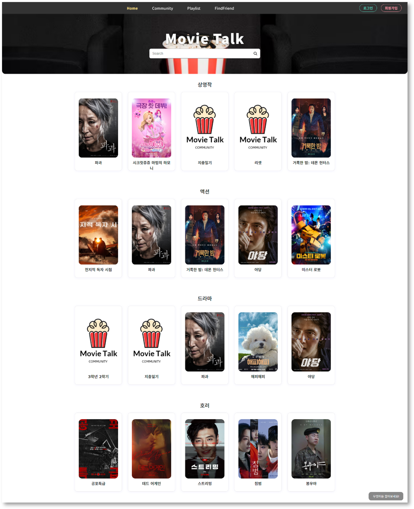

---
# multilingual page pair id, this must pair with translations of this page. (This name must be unique)
lng_pair: id_movietalk
title: "MovieTalk - 영화 취향을 공유하는 캡스톤 웹 서비스"

# post specific
# if not specified, .name will be used from _data/owner/[language].yml
#author: ""
# multiple category is not supported
category: 프로젝트
# multiple tag entries are possible
tags: [캡스톤, React, Spring Boot, JPA, MySQL, 팀 프로젝트]
# thumbnail image for post
img: "/assets/img/projects/movietalk.png"
# disable comments on this page
#comments_disable: true

# publish date
date: 2025-06-11 09:00:00 +0900

# seo
# if not specified, date will be used.
#meta_modify_date: 2025-06-11 09:00:00 +0900
# check the meta_common_description in _data/owner/[language].yml
#meta_description: ""

# to disable this page, simply set published: false or delete this file
#published: false
---

<!-- outline-start -->

영화 정보를 검색하고 리뷰를 남기는 데서 그치지 않고, 좋아하는 영화를 모아 **다른 사용자와 취향을 공유**할 수 있는 영화 플랫폼 **MovieTalk**를 4인 캡스톤 팀에서 개발했습니다. 저는 팀장으로 참여해 마이페이지(커스텀 영화제), 플레이리스트, 친구 찾기 기능의 백엔드를 구현하고 React 화면과 연동했으며, 최종 발표를 맡았습니다.

<!-- outline-end -->

{:data-align="center"}

### 프로젝트 개요

| 항목 | 내용 |
| --- | --- |
| 기간 | 2025.03 ~ 2025.06 |
| 인원 | 4인 (캡스톤디자인) |
| 역할 | 팀장, 백엔드, 프론트-백 연동, 최종 발표 |
| 기술 스택 | React, Spring Boot, Spring Data JPA, MySQL |

React 프론트엔드가 Spring Boot 백엔드에 REST API로 요청을 보내고, 백엔드는 MySQL에서 데이터를 읽고 써서 응답하는 구조입니다.

### 주요 기능

- **회원 관리**: 일반 로그인과 소셜 로그인, 회원가입
- **영화 정보**: 장르별 영화 목록, 키워드 검색, 상세 정보 조회
- **리뷰**: 영화별 별점과 리뷰 작성
- **커뮤니티**: 자유, 영화 리뷰, 질문·추천 게시판과 댓글
- **커스텀 영화제(마이페이지)**: 나만의 즐겨찾기 영화 TOP3 등록
- **친구 찾기**: 다른 사용자의 영화제 조회
- **플레이리스트**: 주제별로 영화를 묶어 공유
- **AI 챗봇**: GPT 기반 사용자 맞춤 영화 추천

기존 영화 커뮤니티가 기사나 리뷰 중심이라면, MovieTalk는 **영화제와 플레이리스트로 자신의 취향을 표현하고 공유하는 공간**이라는 점을 차별점으로 잡았습니다.

### 내가 맡은 부분

#### 1. 마이페이지: 커스텀 영화제

마이페이지에서 좋아하는 영화 3편을 골라 나만의 영화제를 꾸밀 수 있습니다. 영화제 등록, 조회, 수정, 삭제(CRUD) 기능을 구현했습니다. 마이페이지에서는 닉네임과 영화제, 내가 만든 플레이리스트를 한 화면에서 확인할 수 있습니다.

{:data-align="center"}

영화를 검색해 영화제에 넣을 영화를 고르는 수정 화면입니다.

{:data-align="center"}

#### 2. 플레이리스트

영화를 검색해 골라 담고, 이름을 붙여 플레이리스트를 만들 수 있습니다. 플레이리스트 등록, 조회, 수정, 삭제 기능을 구현했습니다.

{:data-align="center"}

다른 사용자가 만든 플레이리스트도 목록에서 검색하고, 상세 화면에서 담긴 영화를 확인할 수 있습니다.

{:data-align="center"}

{:data-align="center"}

#### 3. 친구 찾기

다른 사용자의 닉네임을 검색하면 그 사용자의 영화제(추천 영화 TOP3)를 볼 수 있는 기능을 구현했습니다. 비슷한 취향을 가진 사용자를 찾고, 새로운 영화를 발견하는 큐레이션 역할을 합니다.

{:data-align="center"}

#### 4. 팀장 역할

- 서비스의 UI를 구상했습니다.
- 백엔드 API와 React 화면을 연동했습니다.
- 최종 발표를 맡았습니다.

### 느낀 점

- Spring Data JPA를 처음 사용하면서, 메서드 이름만으로 쿼리를 만들 수 있는 편리함과 간결함을 체감했습니다.
- API를 설계할 때 사용자를 닉네임으로 식별할지 ID로 식별할지 고민이 있었습니다. 닉네임은 바뀔 수 있기 때문에, 연동성과 안정성 면에서 기본키(ID)를 쓰는 것이 맞다는 것을 배웠습니다.
- React 화면과 백엔드를 연결해 기능이 실제로 동작하는 것을 확인하며 큰 보람과 재미를 느꼈습니다.

### 링크

- [팀 저장소](https://github.com/MOVlETALK/MovieTalk)
- [내 커밋 내역](https://github.com/MOVlETALK/MovieTalk/commits/main/?author=GlintJade)
